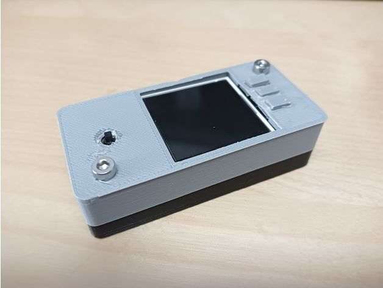

# RPi-docscan

Small service to scan documents using a Waveshare 1.44" HAT on a Raspberry Pi Zero. Scans are saved directly to a samba share; as example on your NAS.

Main features:
- Local OCR support with Tesseract
- Remote OCR support via OCR Space (optional)
- Support for a small OLED/LCD display (Waveshare 1.44")
- Pushover notifications to your smartphone



## Installation

Prepare your Raspberry Pi environment and enable the SPI interface:

```bash
sudo raspi-config
# Interfacing Options -> SPI -> enable
```

Install required system packages:

```bash
sudo apt update
sudo apt install -y python3-pip python3-pil git libatlas-base-dev sane-utils tesseract-ocr-deu imagemagick
```

Install Python dependencies:

```bash
sudo pip3 install RPi.GPIO psutil numpy netifaces spidev Pillow PyPDF2
```

Clone the tool:

```bash
cd /opt
sudo git clone https://github.com/Starwhooper/RPi-docscan
```

(Adjust packages as needed, e.g. add other Tesseract language packs.)

## First configuration

Copy the example configuration and edit it:

```bash
sudo cp /opt/RPi-docscan/config.json.example /opt/RPi-docscan/config.json
sudo nano /opt/RPi-docscan/config.json
```

Edit `config.json` to match your environment (NAS path, OCR settings, Pushover token, display options, etc.).

This tool uses SANE for scanning. Helpful commands:
- Find available device names:
```bash
sudo /usr/bin/scanimage -L
```
- Show all possible settings for your device:
```bash
/usr/bin/scanimage --device-name="YOUR_DEVICE_NAME" -A
```
Example device string: `pixma:04A9190D` — replace with your device.

SANE documentation: http://www.sane-project.org/man/scanimage.1.html

## Start / Autostart

Using systemd is recommended (more reliable than crontab). Example service unit:

Create `/etc/systemd/system/rpi-docscan.service` with contents similar to:

```ini
[Unit]
Description=RPi Docscan Service
After=network.target

[Service]
Type=simple
ExecStart=/usr/bin/python3 /opt/RPi-docscan/scan.py
WorkingDirectory=/opt/RPi-docscan
Restart=always
User=root
Environment=PATH=/usr/bin:/usr/local/bin

[Install]
WantedBy=multi-user.target
```

Then enable and start the service:

```bash
sudo systemctl daemon-reload
sudo systemctl enable rpi-docscan.service
sudo systemctl start rpi-docscan.service
```

Alternative (less recommended) — root crontab autostart:

```bash
sudo crontab -e
# add:
@reboot /usr/bin/python3 /opt/RPi-docscan/scan.py
```

Make sure to use the correct python path and script path.

## Update

If already installed, update with:

```bash
cd /opt/RPi-docscan
sudo git pull origin main
```

Then restart the service if using systemd:

```bash
sudo systemctl restart rpi-docscan.service
```

## Hardware

Case to enclose Raspberry Pi Zero and Waveshare 1.44" LCD HAT:
https://www.printables.com/de/model/258922

Ensure GPIO/SPI connections are correct and the display library used is compatible with your HAT.

## Troubleshooting & Tips

- Scanner not detected: run `sudo /usr/bin/scanimage -L` to list devices.
- Improve OCR results by image preprocessing (ImageMagick) or Tesseract parameters.
- NAS permissions: ensure the service user has write access to the mounted NAS. If the service runs as root, ensure mounts are available at boot.
- Check logs when using systemd:
```bash
journalctl -u rpi-docscan.service -f
```
